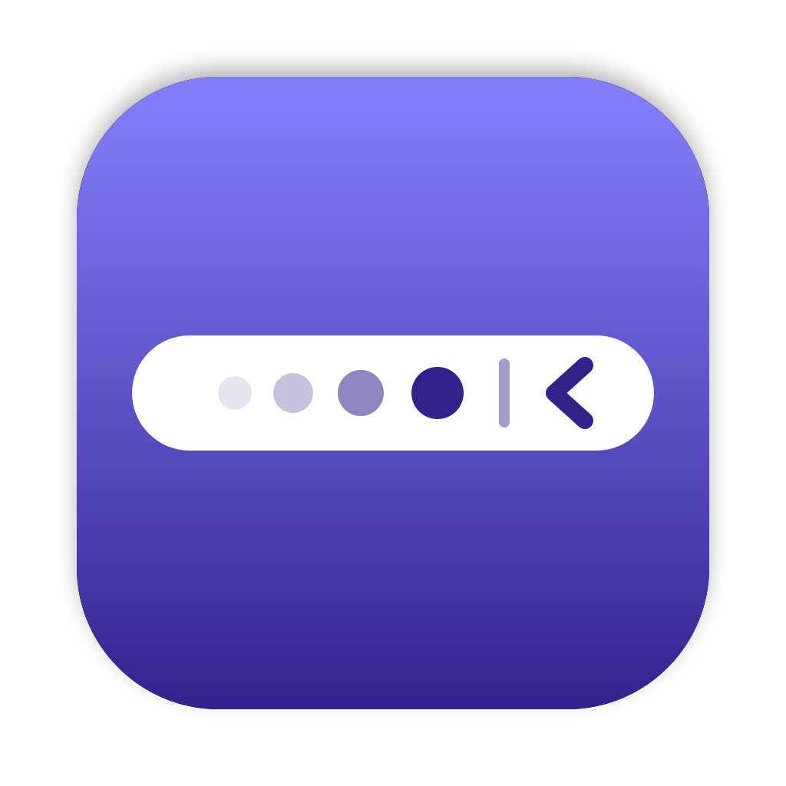
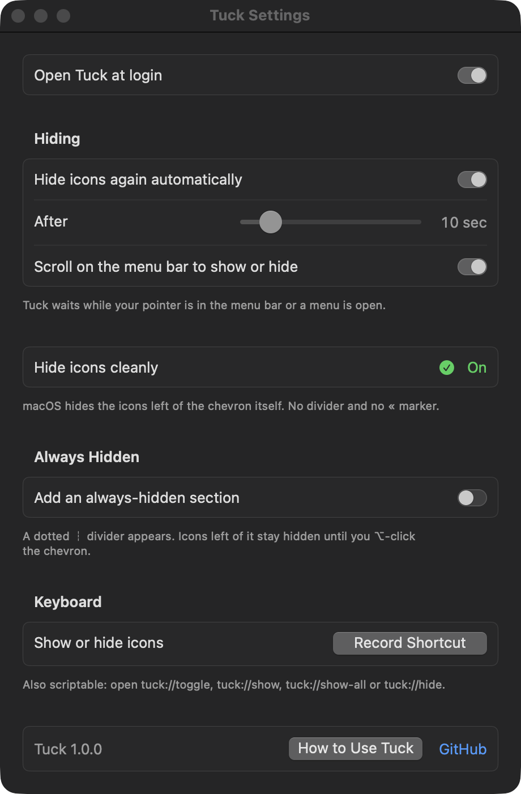

# Tuck



Tuck hides the menu bar icons you don't need to see all the time. Hold ⌘, drag them to the left of a thin divider, and they're gone until you click the chevron.

I used [Hidden Bar](https://github.com/dwarvesf/hidden) for years. On macOS 27 it stopped hiding anything, and some parts always felt a bit rough, so I rewrote it from scratch. Tuck does the same thing, with more care in the details.


## Install

Build it from source. Prebuilt downloads will go on the [Releases](https://github.com/frizurd/tuck/releases) page once there's a notarized build.

```sh
git clone https://github.com/frizurd/tuck.git
cd tuck
./build.sh
cp -R build/Tuck.app /Applications/
open /Applications/Tuck.app
```

You'll need Xcode 15 or newer. Tuck runs on macOS 14 Sonoma and later, and it has no third-party dependencies.

## Using it

Tuck adds two things to your menu bar: a chevron `‹` and a thin divider `│`.

- **Hold ⌘ and drag icons to the left of the divider.** Those are the hidden ones.
- **Click the chevron** to show them, and click it again to hide them.
- **Scroll on the menu bar** to do the same thing without aiming for the chevron.
- **Set a shortcut** in Settings to show or hide them from anywhere.
- **Right-click the chevron** for Settings, the welcome guide, and Quit.

After 10 seconds the icons hide again on their own. Tuck waits while your pointer is in the menu bar or any menu is open, so it won't pull an icon away while you're using it. You can change the delay or turn this off.

If you also want an **always-hidden** section, turn it on in Settings. A dotted `┆` divider appears. Icons to the left of it stay hidden until you ⌥-click the chevron.

If the divider ends up on the wrong side of the chevron, Tuck won't hide anything, because that would hide the chevron as well. It shows a popover telling you how to fix it.



## Scripting

Tuck handles a `tuck://` URL scheme, so Shortcuts, Raycast, Alfred, or a shell script can control it:

```sh
open -g tuck://toggle
open -g tuck://show
open -g tuck://show-all   # including the always-hidden section
open -g tuck://hide
open tuck://settings
```

## How it works

The divider is an ordinary status item. To hide icons, Tuck makes it very wide so the icons to its left no longer fit in the menu bar.

Before macOS 26, apps made the divider 10,000 points wide and the extra icons just ran off the screen. macOS 26 and later lay the menu bar out differently. A status item that would run into the app menus gets ignored completely, which is why Hidden Bar stopped working.

So Tuck stretches the divider to just short of where the front app's menus end. There's no room left for any icon, so macOS quietly drops the icons on the left of the divider. Tuck measures again every time you switch apps. Reading the menu width needs Accessibility access, and Tuck asks for it in Settings under **Hide without the « marker**. It reads only the menu width.

Without that access, Tuck aims the divider's edge at the middle of the notch instead. Nothing can be placed there, so macOS moves the divider and the icons on its left into its own overflow. That always hides them, but macOS then shows a `«` next to the chevron. On macOS 14 and 15, Tuck uses the old 10,000-point trick.

The divider's line is blank while the divider is stretched or resizing, so it doesn't slide across the menu bar when you click the chevron.

Apart from the optional Accessibility access, Tuck needs no permissions, and it makes no network requests. The shortcut uses the Carbon hot key API, which doesn't need any permission. Open at login uses `SMAppService`.

The decisions live in `Sources/TuckCore` as plain functions with tests: which divider width to use, when the divider position is valid, when auto-hide should wait, and how shortcuts and URLs are parsed.

```sh
swift test
```

## Things I haven't nailed yet

- Without Accessibility access, macOS shows its `«` overflow marker next to the chevron while icons are hidden.
- I've tested on a 14" MacBook Pro with a notch, running macOS 27. Without Accessibility access on a display with no notch, Tuck assumes the app menus use less than half the menu bar, so with very long menus a hidden icon could peek out. Reports from external-display setups are welcome.
- Status items appear on every display, but Tuck measures from the display its own chevron is on.

## Credits

Inspired by [Hidden Bar](https://github.com/dwarvesf/hidden) by Dwarves Foundation (MIT). Tuck is a new codebase.

## License

MIT
